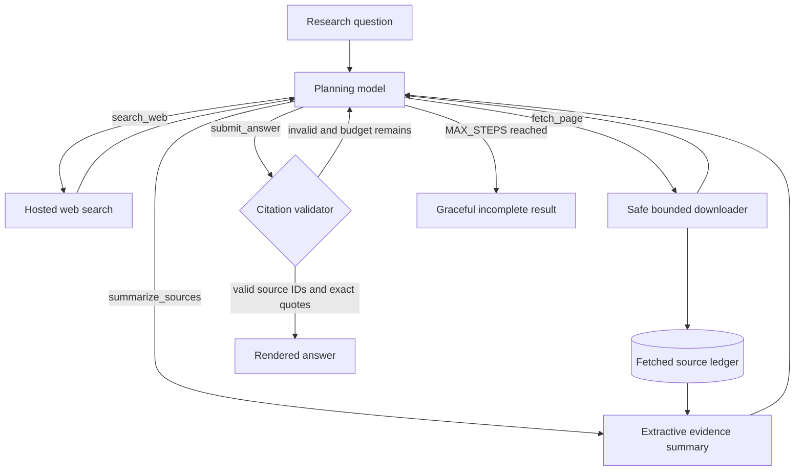

# Tool-Using Research Agent

A bounded web research agent that lets an LLM choose between search, page fetching, evidence summarisation, and final answer submission. Every displayed factual claim is linked to a page the program actually fetched, and its supporting quotation is checked against the fetched text before the answer is accepted.

## Assessment checklist

- **At least two distinct tools:** `search_web`, `fetch_page`, `summarize_sources`, and `submit_answer`.
- **Hard loop limit:** a Python `for` loop permits at most `MAX_STEPS` model decisions; the final decision is constrained to `submit_answer`.
- **Traceable claims:** source IDs exist only for fetched pages, and every evidence quote must be present in the corresponding page text.
- **Graceful failures:** search, HTTP, extraction, malformed call, invalid citation, and step limit failures return structured results instead of crashing the agent.
- **Deliverables:** this repository, three reproducible example transcripts, tests, and a recorded walkthrough script.

## Architecture



The production search adapter uses OpenAI hosted web search and requests the complete search source list. The outer model still sees `search_web` as an application defined tool and chooses when to use it. OpenAI's official documentation describes both [function calling](https://developers.openai.com/api/docs/guides/function-calling) and the [web search tool](https://developers.openai.com/api/docs/guides/tools-web-search).

## Tool behavior

### `search_web(query)`

Returns titles and URLs from web search. It also adds those URLs to the candidate allowlist. Search snippets are explicitly marked as non evidence.

### `fetch_page(url)`

Accepts only a URL previously returned by `search_web`. It:

- permits only public `http` and `https` destinations;
- blocks loopback, private, link local, reserved, and multicast addresses;
- validates every redirect;
- applies time, byte, redirect, and extracted text limits;
- accepts HTML and plain text only;
- strips scripts, styles, SVG, templates, and other non readable content;
- assigns `S1`, `S2`, and so on only after a successful fetch.

### `summarize_sources(source_ids, focus)`

Uses deterministic extractive scoring to return relevant sentences verbatim. Because it is extractive, the returned evidence passages can be checked directly against the fetched page.

### `submit_answer(title, claims, limitations)`

Each claim must include at least one `{source_id, quote}` evidence object. Submission fails when:

- the source ID was never fetched;
- the quotation is shorter than 20 characters;
- the normalized quotation is absent from the fetched text;
- a claim has no evidence;
- both claims and limitations are empty.

Only a validated submission is rendered as the final answer.

## Requirements

- Python 3.10 or newer
- An OpenAI API key
- A Responses API model available to your account that supports function calling and web search
- Public internet access for live runs

Only the official `openai` Python package is required. Page fetching, HTML extraction, environment loading, testing, and the offline demos use the Python standard library.

## Setup

### Windows PowerShell

```powershell
py -m venv .venv
.\.venv\Scripts\Activate.ps1
python -m pip install --upgrade pip
python -m pip install -e .
Copy-Item .env.example .env
```

Edit `.env` and set `OPENAI_API_KEY`. Change `OPENAI_MODEL` if the default is not available to your account.

### macOS or Linux

```bash
python3 -m venv .venv
source .venv/bin/activate
python -m pip install --upgrade pip
python -m pip install -e .
cp .env.example .env
```

## Run the agent

```bash
research_agent "What are the major benefits and limitations of heat pumps?" --trace
```

Equivalent module command:

```bash
python -m research_agent "What are the major benefits and limitations of heat pumps?" --trace
```

Save a result:

```bash
research_agent "Compare two approaches to long duration energy storage" --trace --output run_output/storage.md
```

Machine readable output:

```bash
research_agent "What changed in the latest Python release?" --json
```

Exit code `0` means a validated answer was submitted. Exit code `2` means the hard step limit was reached without a valid answer.

## Configuration

| Variable | Default | Purpose |
|---|---:|---|
| `OPENAI_API_KEY` | required | OpenAI API authentication |
| `OPENAI_MODEL` | `gpt-5-mini` | Model used for planning and hosted search |
| `MAX_STEPS` | `8` | Maximum outer model decisions |
| `MAX_SEARCH_RESULTS` | `5` | Candidate URLs returned per search |
| `FETCH_TIMEOUT_SECONDS` | `12` | Page request timeout |
| `MAX_PAGE_BYTES` | `2000000` | Maximum downloaded bytes |
| `MAX_PAGE_CHARS` | `24000` | Maximum extracted characters returned to the agent |
| `MAX_REDIRECTS` | `3` | Maximum manually validated redirects |
| `MAX_MODEL_RETRIES` | `2` | Retries for transient model-request failures |

The step budget is enforced by application code, not merely by an instruction in the prompt. `parallel_tool_calls=False` also keeps every outer decision to at most one custom function call.

## Run the tests

The test suite uses no API key and makes no network requests:

```bash
python -m unittest discover -s tests -v
python -m compileall -q src tests
```

Tests cover:

- a successful search → fetch → submit sequence;
- the hard step limit and final forced submission choice;
- rejection of URLs not discovered by search;
- unknown source IDs;
- fabricated evidence quotations;
- accepted exact quotations;
- structured fetch failures;
- unsafe URL schemes;
- exact extractive summaries.

## Three example runs

The repository contains three transcripts generated by the deterministic offline demo. The demo uses the same agent controller, tools, source ledger, step budget, failure objects, renderer, and citation validator as live mode; only the model decisions, search results, and page bodies are scripted so the examples are reproducible without API credits.

1. [Successful multi tool research](examples/run_1_success.md)
2. [Citation versus source comparison](examples/run_2_comparison.md)
3. [Fetch failure and graceful recovery](examples/run_3_failure_recovery.md)

Regenerate all three:

```bash
python -m research_agent.demo --write_examples examples
```

For a final submission, it is also useful to capture at least one live run with your own API key and add that transcript beside these deterministic examples.

## Recorded walkthrough

Use [docs/WALKTHROUGH_SCRIPT.md](docs/WALKTHROUGH_SCRIPT.md) for a concise 3–5 minute recording. It covers the rubric, a live or offline run, failure recovery, the hard limit, citation checking, and tests.

## Repository map

```text
src/research_agent/
├── agent.py          # bounded model/tool controller
├── cli.py            # command line interface
├── config.py         # .env and numeric settings
├── demo.py           # deterministic example generator
├── fetch.py          # safe downloader and HTML extraction
├── models.py         # shared data structures
├── prompts.py        # research policy and prompt injection boundary
├── schemas.py        # strict function schemas
├── search.py         # hosted and static search adapters
├── source_store.py   # candidate URLs and fetched source ledger
├── summarize.py      # extractive evidence selection
└── tools.py          # tool dispatch, validation, and rendering
```

## Important design decisions

### Search results are not evidence

A search provider can return incomplete snippets. The project therefore creates source IDs only after downloading and extracting a page.

### Citations are checked outside the model

Prompting the model to cite sources is not a guarantee. `submit_answer` performs deterministic validation, so an invented `S99` or fabricated quote is rejected and returned to the model as a tool error.

### Fetched text is untrusted

The planning prompt states that instructions found inside web pages are data, not commands. Network fetching additionally restricts schemes, destinations, redirects, sizes, and content types.

### The agent cannot loop indefinitely

`ResearchAgent.run` uses `range(1, MAX_STEPS + 1)`. On the last round it asks the API to force `submit_answer`. Even if a model or fake test client ignores that instruction, the loop exits and returns a controlled incomplete result.

## Known limitations

- Some sites block automated fetching or render their content only with JavaScript.
- PDF extraction is intentionally out of scope; the agent should search for an HTML alternative.
- Exact quote validation proves traceability, not that a claim is logically entailed by its quotation.
- DNS rebinding cannot be eliminated completely by a small client side educational fetcher; production deployments should also enforce outbound network policy at the infrastructure layer.
- The in memory source ledger is scoped to one process and is not a persistent database.

## License

MIT

## Fetch security

Page downloads validate public DNS answers at connection time and connect to the checked numeric address. TLS verifies the original hostname. Private, shared, loopback, link-local and mixed public/private DNS answers are rejected on every redirect. Ambient HTTP proxy settings are not used because they move DNS and routing decisions outside that boundary.
